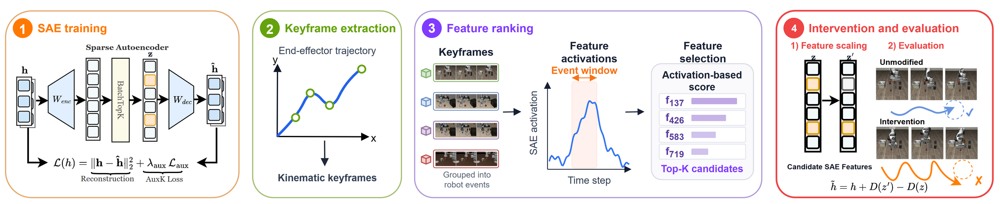
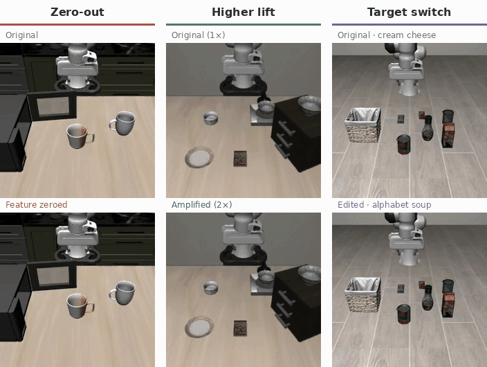

# Event-SAE

Code for [Event-Grounded Sparse Autoencoders for Vision-Language-Action Policies](https://arxiv.org/abs/2605.17204) (NeurIPS 2026).

Supports OpenVLA and OpenPI (pi0.5) on LIBERO.

[Paper](https://arxiv.org/abs/2605.17204) · [Installation](#installation) · [Pipeline](#pipeline)

<p align="center">
  
</p>

## Installation

Run commands from the repository root. First install LIBERO:

```bash
mkdir -p external
git clone https://github.com/Lifelong-Robot-Learning/LIBERO.git external/LIBERO
git -C external/LIBERO checkout f78abd6
touch external/LIBERO/libero/__init__.py
touch external/LIBERO/libero/lifelong/models/modules/__init__.py
```

### OpenVLA and analysis

Install this environment for OpenVLA and for analysis with either backend.

```bash
conda env create -f configs/environments/openvla.yml
conda activate event-sae-openvla
python -m pip install --no-deps 'https://github.com/Dao-AILab/flash-attention/releases/download/v2.5.5/flash_attn-2.5.5%2Bcu122torch2.2cxx11abiFALSE-cp310-cp310-linux_x86_64.whl'
python -m pip install --no-deps -e external/LIBERO
python -m pip install -e '.[sae,analysis,vlm,wandb]'
```

### OpenPI

OpenPI also needs separate server and client environments.

**Server**

```bash
GIT_LFS_SKIP_SMUDGE=1 uv sync --directory third_party/openpi --locked --no-dev --python 3.11 --managed-python
uv pip install --python third_party/openpi/.venv/bin/python --no-deps -e .
```

**Client**

```bash
uv venv --python 3.8 --managed-python .venv-openpi-client
uv pip install --python .venv-openpi-client/bin/python -r configs/environments/openpi-libero.txt
uv pip install --python .venv-openpi-client/bin/python \
  -c configs/environments/openpi-libero.txt -e third_party/openpi/packages/openpi-client
uv pip install --python .venv-openpi-client/bin/python --no-deps -e external/LIBERO -e .
```

## Pipeline

Choose OpenVLA or OpenPI below. The examples collect 50 LIBERO-Goal episodes,
train an SAE, rank features against events, and run one intervention episode.
Both backends share the event analysis steps.

<details>
<summary>Other LIBERO suites</summary>

| Suite | OpenPI `--suite` | OpenVLA `--model-config` |
|---|---|---|
| Spatial | `libero_spatial` | `configs/models/openvla_libero_spatial.yaml` |
| Object | `libero_object` | `configs/models/openvla_libero_object.yaml` |
| Goal | `libero_goal` | `configs/models/openvla_libero_goal.yaml` |
| Long | `libero_10` | `configs/models/openvla_libero_10.yaml` |

OpenPI uses `configs/models/openpi_libero.yaml` for every suite.
Run the pipeline separately for each suite, keeping its outputs in a separate
directory. Use `--task-ids 0-9 --initial-states 0-9` to collect 100 episodes.

</details>

### 1. SAE training

#### OpenVLA

Collect activations and trajectories:

```bash
conda activate event-sae-openvla
python scripts/rollout_native.py --backend openvla \
  --model-config configs/models/openvla_libero_goal.yaml \
  --collect-config configs/collection/openvla.yaml \
  --task-ids 0-9 --initial-states 0-4 --output outputs/rollout
```

Train the SAE and extract sparse features:

```bash
python scripts/train_sae.py --config configs/sae/openvla.yaml \
  --override data_dir=outputs/rollout/sae_activations/resid_post \
  --save-dir outputs/sae/openvla-layer31

python scripts/extract_topk.py \
  --dense-dir outputs/rollout/sae_activations/resid_post \
  --sae-checkpoint outputs/sae/openvla-layer31/trainer_0/ae.pt \
  --layer-idx 31 --topk 64 --output-dir outputs/topk
```

#### OpenPI

Start the collection server:

```bash
third_party/openpi/.venv/bin/python third_party/openpi/scripts/serve_policy.py \
  --model-config configs/models/openpi_libero.yaml \
  --collect-config configs/collection/openpi_action_expert.yaml \
  --sae.output-root outputs/openpi --sae.run-name collection --port 8000
```

Run the LIBERO client in a second terminal:

```bash
.venv-openpi-client/bin/python scripts/rollout_native.py --backend openpi \
  --collect-config configs/collection/openpi_action_expert.yaml \
  --suite libero_goal --task-ids 0-9 --initial-states 0-4 \
  --host localhost --port 8000 --output outputs/rollout
```

Stop the server after collection, then train the SAE and extract sparse features:

```bash
conda activate event-sae-openvla
python scripts/train_sae.py --config configs/sae/openpi_action_expert.yaml \
  --override data_dir=outputs/openpi/collection/sae_activations/resid_post \
  --save-dir outputs/sae/openpi-action-expert-layer5

python scripts/extract_topk.py \
  --dense-dir outputs/openpi/collection \
  --sae-checkpoint outputs/sae/openpi-action-expert-layer5/trainer_0/ae.pt \
  --layer-idx 5 --topk 64 --output-dir outputs/topk
```

<details>
<summary>PaliGemma instead of the action expert</summary>

For PaliGemma, use the following commands instead of the action-expert commands above.

Start the collection server:

```bash
third_party/openpi/.venv/bin/python third_party/openpi/scripts/serve_policy.py \
  --model-config configs/models/openpi_libero.yaml \
  --collect-config configs/collection/openpi_paligemma.yaml \
  --sae.output-root outputs/openpi --sae.run-name collection-paligemma --port 8000
```

Run the LIBERO client in a second terminal:

```bash
.venv-openpi-client/bin/python scripts/rollout_native.py --backend openpi \
  --collect-config configs/collection/openpi_paligemma.yaml \
  --suite libero_goal --task-ids 0-9 --initial-states 0-4 \
  --host localhost --port 8000 --output outputs/rollout
```

Stop the server after collection, then train the SAE and extract sparse features:

```bash
conda activate event-sae-openvla
python scripts/train_sae.py --config configs/sae/openpi_paligemma.yaml \
  --override data_dir=outputs/openpi/collection-paligemma/sae_activations/resid_post__paligemma \
  --save-dir outputs/sae/openpi-paligemma-layer0

python scripts/extract_topk.py \
  --dense-dir outputs/openpi/collection-paligemma \
  --sae-checkpoint outputs/sae/openpi-paligemma-layer0/trainer_0/ae.pt \
  --layer-idx 0 --topk 64 --output-dir outputs/topk
```

</details>

### 2. Kinematic keyframe extraction

Use AWE to select trajectory keyframes, then extract frames and clips:

```bash
conda activate event-sae-openvla
python scripts/extract_keyframes.py \
  --trajectory-records-path outputs/rollout/trajectory_records.jsonl \
  --output-dir outputs/keyframes
python scripts/extract_keyframe_media.py \
  --waypoint-summary-path outputs/keyframes/waypoint_summary.json \
  --output-dir outputs/events
```

### 3. Event clustering and annotation

Cluster keyframes within each task using visual, state and progress descriptors:

```bash
python scripts/build_event_features.py --samples-path outputs/events/samples.jsonl
python scripts/cluster_events.py --event-features-path outputs/events/event_features.jsonl
```

SigLIP downloads on first use.

<details>
<summary>Optional: label clusters with Gemini</summary>

Set `GEMINI_API_KEY` or pass `--api-key-path`:

```bash
python scripts/annotate_clusters.py \
  --clusters-path outputs/events/clusters/clusters.jsonl \
  --model gemini-2.5-flash \
  --output-path outputs/events/clusters/annotations.jsonl
```

</details>

### 4. Closed-loop validation

Score features against event clusters:

```bash
python scripts/score_cluster_features.py \
  --topk-run-dir outputs/topk \
  --event-features-path outputs/events/event_features.jsonl \
  --cluster-assignments-path outputs/events/clusters/cluster_assignments.jsonl \
  --clusters-path outputs/events/clusters/clusters.jsonl \
  --prompt-records-path outputs/rollout/prompt_records.jsonl \
  --output-path outputs/scores.pt
```

Rank candidates (use `--top-k 3` for OpenPI):

```bash
python scripts/build_feature_rankings.py \
  --scores-pt outputs/scores.pt \
  --topk-run-dir outputs/topk \
  --top-k 5 --seed 0 --output-dir outputs/rankings
```

To zero the top event-aligned feature, replace `feature_id` in your backend's
`configs/steering/` YAML with:

```yaml
candidates: outputs/rankings/candidates.jsonl
ranking: event_aligned
rank: 1
```

Keep `mode: feature` and `feature_alpha: 0.0`, and set `sae_checkpoint` to the
checkpoint from stage 1. Then run one episode below.

<details>
<summary>Intervention modes</summary>

Set these fields in the steering YAML:

| `mode` | Behavior |
|---|---|
| `native` | Run the policy without an SAE intervention. |
| `reconstruction` | Replace activations with their SAE reconstruction. |
| `feature` | Edit selected features while preserving the SAE reconstruction residual. |

For `mode: feature`, `feature_alpha` controls the intervention:
0 zeros the feature, 0–1 suppresses it, 1 leaves it unchanged, and >1 amplifies it.
Set `ranking` to `event_aligned`, `window_mean`, `task_mean` or `random_alive`,
and `rank` to the desired position in that ranking.

</details>

#### OpenVLA

```bash
conda activate event-sae-openvla
python scripts/rollout_steered.py --backend openvla \
  --model-config configs/models/openvla_libero_goal.yaml \
  --steer-config configs/steering/openvla.yaml \
  --task-id 0 --initial-state 0 --seed 0 --output outputs/steered-openvla
```

#### OpenPI

Start the steering server:

```bash
third_party/openpi/.venv/bin/python third_party/openpi/scripts/serve_policy.py \
  --model-config configs/models/openpi_libero.yaml \
  --steer-config configs/steering/openpi_action_expert.yaml --port 8000
```

Run the client in a second terminal:

```bash
.venv-openpi-client/bin/python scripts/rollout_steered.py --backend openpi \
  --suite libero_goal --task-id 0 --initial-state 0 --seed 0 \
  --host localhost --port 8000 --replan-steps 5 --output outputs/steered-openpi
```

For PaliGemma steering, use `configs/steering/openpi_paligemma.yaml`.

<details>
<summary>Batch evaluation</summary>

Use `--task-ids` and `--initial-states` to evaluate multiple episodes.
For all 100 LIBERO-Goal episodes:

**OpenVLA**

```bash
conda activate event-sae-openvla
python scripts/rollout_steered.py --backend openvla \
  --model-config configs/models/openvla_libero_goal.yaml \
  --steer-config configs/steering/openvla.yaml \
  --task-ids 0-9 --initial-states 0-9 --seed 0 \
  --output outputs/steered-openvla-batch
```

**OpenPI** — with the steering server above running:

```bash
.venv-openpi-client/bin/python scripts/rollout_steered.py --backend openpi \
  --suite libero_goal --task-ids 0-9 --initial-states 0-9 --seed 0 \
  --host localhost --port 8000 --replan-steps 5 \
  --output outputs/steered-openpi-batch
```

Give each intervention condition its own output directory. Restart the OpenPI
server whenever its steering config changes. Each batch writes success counts,
success rate and episode result paths to `summary.json` in the output directory.

</details>

<p align="center">
  
  <br>
  <em>Selected rollouts; intervention effects vary across episodes.</em>
</p>

## Licenses

Event-SAE code is under [MIT](LICENSE). Bundled code retains its upstream licensing:
[OpenVLA evaluation utilities](third_party/openvla/README.md),
[OpenPI](third_party/openpi/README.md), [dictionary_learning](third_party/dictionary_learning/README.md),
[AWE](third_party/awe/README.md). Models and LIBERO retain their respective licenses.
